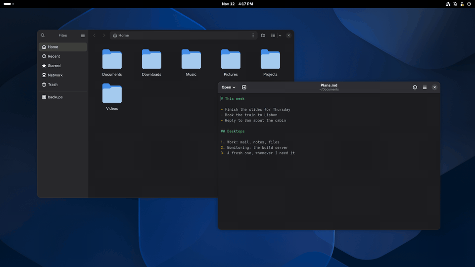
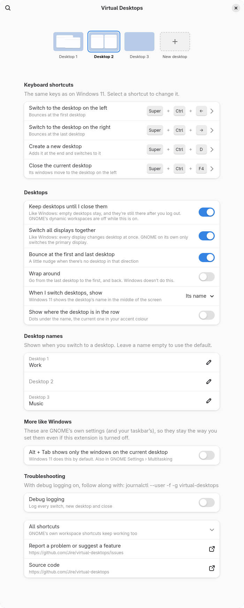

# Virtual Desktops

Windows 11 virtual desktops for GNOME, with the same keyboard shortcuts: <kbd>Super</kbd>+<kbd>Ctrl</kbd>+<kbd>←</kbd> / <kbd>→</kbd> to switch, <kbd>Super</kbd>+<kbd>Ctrl</kbd>+<kbd>D</kbd> for a new desktop, <kbd>Super</kbd>+<kbd>Ctrl</kbd>+<kbd>F4</kbd> to close one.

<p align="center">
  
</p>

- **The Windows shortcuts.** <kbd>Super</kbd>+<kbd>Ctrl</kbd>+<kbd>←</kbd> / <kbd>→</kbd> switch to the desktop on the left or right, <kbd>Super</kbd>+<kbd>Ctrl</kbd>+<kbd>D</kbd> adds a new desktop at the end and takes you there, <kbd>Super</kbd>+<kbd>Ctrl</kbd>+<kbd>F4</kbd> closes the one you're on. (<kbd>Super</kbd> is the Windows key.)
- **Closing a desktop keeps your windows.** They move to the desktop on the left (to the right, if you close the first one) and stay exactly where they were on screen while that desktop slides in underneath them.
- **The desktop's name pops up** in the middle of the screen as you switch, like on Windows 11. Give your desktops names (Work, Games, Music…) in the settings, or keep "Desktop 1", "Desktop 2"…
- **Desktops stay until you close them**, even empty ones, and they're still there after you log out or restart.
- **A bounce at the ends.** On the first or last desktop the screen nudges and springs back, so you can tell there's nothing further that way.
- **Every display switches together**, like on Windows. (GNOME on its own only switches the primary display.)
- **Everything else keeps working**: GNOME's overview, its own workspace shortcuts and touchpad swipes all see the same desktops.

GNOME calls desktops "workspaces", and normally adds and removes them on its own. This extension switches that off while it's turned on, since Windows never deletes a desktop you didn't close, and gives GNOME its own behaviour back when it's turned off.

**If this is useful to you, please ⭐ [star the repo](https://github.com/Jire/virtual-desktops) and [follow @Jire on GitHub](https://github.com/Jire) for more free tools like this.**

## Install

Paste the command for your distro into a terminal. Don't use `sudo`: it installs into your home folder.

**Arch Linux, EndeavourOS, CachyOS, Manjaro**

```bash
curl -fsSL https://raw.githubusercontent.com/Jire/virtual-desktops/main/install.sh | bash
```

**Fedora and Fedora-based**

```bash
curl -fsSL https://raw.githubusercontent.com/Jire/virtual-desktops/main/install.sh | bash
```

**Ubuntu and Ubuntu-based** (uses `wget`, which Ubuntu ships with by default)

```bash
wget -qO- https://raw.githubusercontent.com/Jire/virtual-desktops/main/install.sh | bash
```

Then **log out and back in**. GNOME only loads newly installed extensions at login (or see the next section to load it right away).

### Load without logging out (Wayland)

GNOME's built-in Looking Glass console can load the extension into the running session:

1. Press <kbd>Alt</kbd>+<kbd>F2</kbd>, type `lg`, press <kbd>Enter</kbd>.
2. Paste this line into the prompt at the bottom and press <kbd>Enter</kbd>:

   ```js
   eval(new TextDecoder().decode(imports.gi.GLib.file_get_contents(imports.gi.GLib.get_user_data_dir() + '/virtual-desktops/hot-load.js')[1]))
   ```

3. Press <kbd>Esc</kbd>. A notification confirms it loaded.

This also works for reloading after an update. At your next normal login the regular installed copy loads as usual.

## How to use

| Keys | What happens |
| --- | --- |
| <kbd>Super</kbd>+<kbd>Ctrl</kbd>+<kbd>←</kbd> / <kbd>→</kbd> | Switch to the desktop on the left / right. On the first or last desktop, the screen bounces. Hold the keys to keep going. |
| <kbd>Super</kbd>+<kbd>Ctrl</kbd>+<kbd>D</kbd> | Create a new desktop at the end and switch to it. |
| <kbd>Super</kbd>+<kbd>Ctrl</kbd>+<kbd>F4</kbd> | Close the current desktop. Its windows move to the desktop on the left (on the right, for the first desktop), right where they were, and you go with them. The last desktop can't be closed, like on Windows. |

The shortcuts work over any app and in the overview, and you can change them in the settings. GNOME's own ones keep working alongside:

| Keys | What happens |
| --- | --- |
| <kbd>Super</kbd> | The overview: every desktop and window at a glance, like Windows' Task View. Drag a window onto another desktop to move it there. |
| <kbd>Super</kbd>+<kbd>Shift</kbd>+<kbd>Page Up</kbd> / <kbd>Page Down</kbd> | Take the focused window to the desktop on the left / right. |
| Three-finger swipe left / right | Switch desktops with the touchpad. |

### Coming from Windows 11

| On Windows 11 | Here |
| --- | --- |
| <kbd>Win</kbd>+<kbd>Ctrl</kbd>+<kbd>←</kbd> / <kbd>→</kbd>, <kbd>Win</kbd>+<kbd>Ctrl</kbd>+<kbd>D</kbd>, <kbd>Win</kbd>+<kbd>Ctrl</kbd>+<kbd>F4</kbd> | The same keys (<kbd>Super</kbd> is the Windows key) |
| Task View (<kbd>Win</kbd>+<kbd>Tab</kbd>) | The overview: press <kbd>Super</kbd> on its own |
| Task View › right-click a window › Move to | Drag the window onto another desktop in the overview, or right-click its title bar › Move to Workspace Left / Right |
| Show this window on all desktops | Right-click its title bar › Always on Visible Workspace |
| Rename a desktop | Settings › Desktop names |
| <kbd>Alt</kbd>+<kbd>Tab</kbd> and the taskbar show only the current desktop | Optional, in Settings › More like Windows |
| A different wallpaper on each desktop | Not available: GNOME has one wallpaper for all desktops |

## Settings

Open **Extensions** and click the gear next to Virtual Desktops, or run:

```bash
gnome-extensions prefs virtual-desktops@jire.github.io
```

If you don't have the Extensions app, install it with `sudo pacman -S gnome-extensions-app` (Arch), `sudo dnf install gnome-extensions-app` (Fedora) or `sudo apt install gnome-shell-extension-prefs` (Ubuntu).

<picture>
  <source media="(prefers-color-scheme: dark)" srcset="docs/preferences-dark.png">
  
</picture>

| Setting | Default | What it does |
| --- | --- | --- |
| Keyboard shortcuts | Windows 11's | Select one and press the new keys (<kbd>Backspace</kbd> turns it off). If other shortcuts use the same keys, the settings window lists them and can take the keys off them. |
| Keep desktops until I close them | On | Empty desktops stay, and survive logging out. Off gives GNOME's dynamic workspaces back. |
| Switch all displays together | On | Off: only the primary display changes desktop, like GNOME on its own. |
| Bounce at the first and last desktop | On | |
| Wrap around | Off | Go from the last desktop to the first and back. Windows doesn't do this. |
| When I switch desktops, show | Its name | The desktop's name like on Windows 11, GNOME's workspace dots, or nothing. |
| Show where the desktop is in the row | Off | Dots under the name. |
| Desktop names | Desktop 1, Desktop 2… | A custom name stays with its desktop when others are closed. |

The **More like Windows** section has a few optional GNOME settings, in one place: <kbd>Alt</kbd>+<kbd>Tab</kbd> showing only the current desktop's windows, and, with Dash to Panel, Dash to Dock or Ubuntu Dock, a taskbar showing only the current desktop's apps. Both are Windows 11's defaults.

## Update

Run the install command again.

## Uninstall

```bash
curl -fsSL https://raw.githubusercontent.com/Jire/virtual-desktops/main/install.sh | bash -s -- --uninstall
```

(On Ubuntu, swap the start for `wget -qO- …`.) You can also remove it from the **Extensions** app. Either way, GNOME's own workspace settings come back the way you had them as soon as the extension is turned off, and your windows stay where they are.

## Requirements

- **GNOME Shell 46 to 51.** Check yours with `gnome-shell --version`. That covers Ubuntu 24.04 LTS and newer, Fedora 40 and newer, Debian 13, and current Arch and its derivatives.
  - Developed on GNOME 51 (Arch Linux, Wayland). The same automated tests pass on GNOME 46, 48, 49, 50 and 51, each run in a real (headless) GNOME Shell of that version with two monitors, pressing the real keys and moving real app windows: switching, the bounce, creating and closing desktops (with windows on both monitors, minimized ones, focus and stacking), desktop names, the 36-desktop limit, shortcuts pressed in quick succession, the overview, the lock screen, vertical workspace layouts, changed shortcuts, GNOME's own dynamic workspaces, reloading without logging out, and turning the extension off and on again. GNOME 47 sits between 46 and 48 and uses the same code.
  - The few places where GNOME's API differs between versions are handled in one file, `extension/compat.js`.
- Any app works: GTK, Qt, Electron, browsers and XWayland apps (Steam, many games). GNOME Shell itself moves the windows.

## How it works

- **Switching** uses GNOME's own slide animation, and focuses the window you last used on that desktop.
- **Closing** a desktop pins its windows in place for the length of the slide (what "Always on Visible Workspace" does), so the desktop on the left slides in underneath them, then hands them over to it.
- **Persistent desktops:** GNOME's "dynamic workspaces" remove an empty workspace as soon as you leave it, so they're switched off while the extension runs, keeping the desktops you have. GNOME then remembers how many there are across logins. Likewise GNOME's default of switching only the primary display. The original values are kept in the extension's own settings until they're put back, so even a crash can't lose them, and if you change them in GNOME Settings yourself, the extension goes along with that.
- **Names** are GNOME's own workspace names, so other workspace indicators show them too.

## Troubleshooting

```bash
gnome-extensions info virtual-desktops@jire.github.io   # is it enabled? any errors?
journalctl --user -f -g virtual-desktops                 # what it's doing (turn on Debug logging in the settings first)
```

- **A shortcut does nothing, or does something else:** another shortcut probably uses the same keys. Open the settings: a "Shortcut conflicts" section lists them, with a button to take the keys off the other one.
- **Nothing happens at all:** make sure the extension is enabled (above) and that you've logged out and back in since installing it.

If something still looks wrong, turn on **Debug logging**, reproduce it while watching the log, and include the output in an [issue](https://github.com/Jire/virtual-desktops/issues).

## Build from source

```bash
git clone https://github.com/Jire/virtual-desktops.git
cd virtual-desktops
npx --yes eslint@9 .                               # lint
gjs -m tests/unit.test.js                          # unit tests
gjs -m tests/conflicts.test.js                     # shortcut conflict finder
tests/headless/run.sh                              # scenario tests in a separate, headless GNOME Shell
scripts/build.sh                                   # creates dist/<uuid>.shell-extension.zip
./install.sh --zip dist/virtual-desktops@jire.github.io.shell-extension.zip
```

After changing code, rebuild, reinstall with `--zip`, and run the Looking Glass line above to reload without logging out. [AGENTS.md](AGENTS.md) describes the code layout, how it works, and how the headless tests stay apart from your own session.

## Support

This is free software, made in my spare time. The best ways to support it:

- ⭐ [Star the repo](https://github.com/Jire/virtual-desktops), which helps other people find it.
- 👤 [Follow @Jire on GitHub](https://github.com/Jire) to hear about more free tools like this.
- 🐛 [Report bugs or request features](https://github.com/Jire/virtual-desktops/issues).

## License

[GPL-2.0-or-later](LICENSE), the same license as GNOME Shell.
